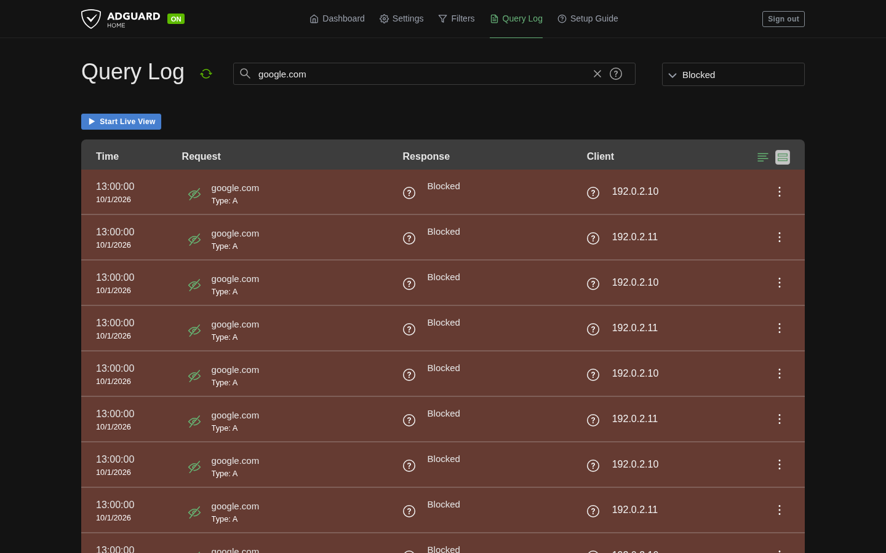
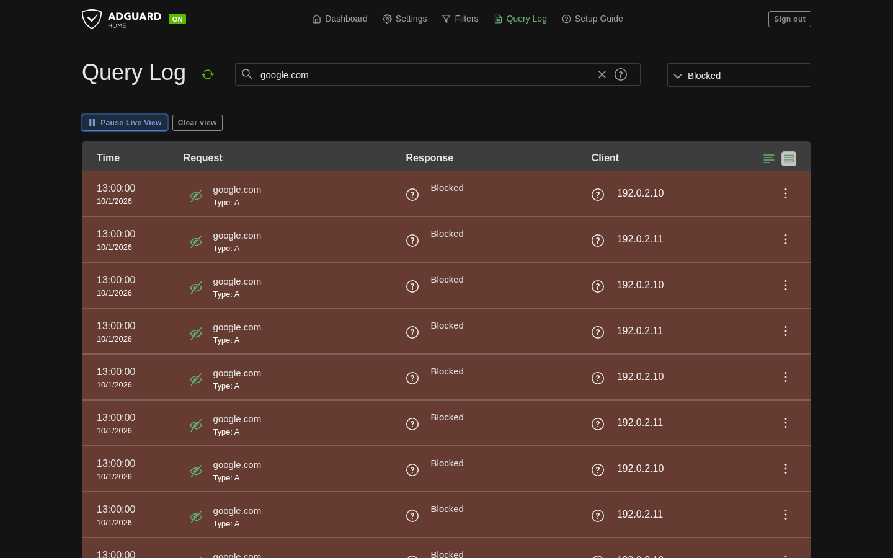
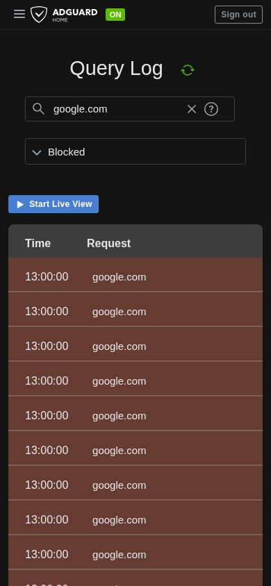
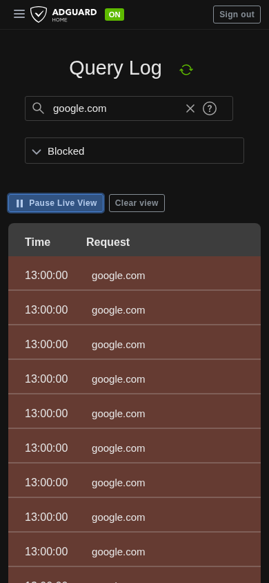
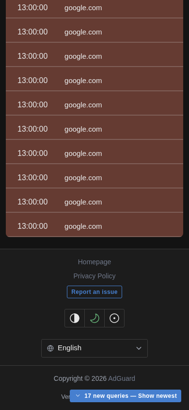

# Live Query Log controls

Click **Start Live View** to start polling. The button turns into **Pause Live View**, and a **Clear view** button appears next to it. Clear view only empties the table in your browser; the server's Query Log isn't touched.

If you've scrolled down to older rows, new queries are held back behind a "17 new queries — Show newest" bar. Clicking it shows them and jumps back to the top.

The screenshots below were taken from the production build using the browser test harness with fixed sample data (blocked queries for `google.com`). Desktop is 1440×900 and mobile 390×844; the tests also cover 320×740.

## How live polling works

Live View polls about once a second, waiting for each request to finish before starting the next. Each poll fetches the newest 100 entries with your current filters. If the previous poll's newest entries aren't on that page, it keeps fetching older pages using the API's `oldest` cursor until it finds them again.

The first poll after you start (or change filters) just sets a baseline; it doesn't load history. After that, the patch remembers the newest timestamp it has seen along with every entry at that timestamp. Overlap is only confirmed when all of those entries show up again.

Pausing, switching tabs, going offline or a failed request doesn't lose your place. Hidden or offline tabs stop polling and catch up when they come back. After an error it waits five seconds before retrying, and shows at most one error toast per outage. The checkpoint is kept in memory only, so reloading the page starts fresh.

Catching up is capped at 10 requests of 100 entries and 5 seconds per cycle. If it hits that limit, or can't otherwise prove continuity, it shows a **Gap detected** warning and carries on from the newest page instead of retrying the same backfill. The warning stays until you change filters or start a new session.

The table keeps at most 500 displayed rows and 500 queued rows.

## Status indicator

- **Live / Synced:** caught up, no known gaps.
- **Catching up:** starting, resuming or fetching extra pages.
- **Reconnecting:** requests are failing or the browser is offline.
- **Suspended:** the tab is hidden.
- **Gap detected:** continuity couldn't be confirmed. Shown alongside the other states.
- **Paused:** Live View is off. Normal history paging still works.

The indicator is an ARIA live region, so screen readers announce changes.

**Clear view** cancels the current poll, removes the rows from the table and hides anything at or older than the newest entry already seen. It never calls the server's clear endpoint.

## API limits

This is best effort, not exactly-once delivery. AdGuard Home's [Query Log API](https://github.com/AdguardTeam/AdGuardHome/blob/v0.107.79/openapi/openapi.yaml#L190-L255) has no unique event ID or snapshot token, and [`older_than` is exclusive](https://github.com/AdguardTeam/AdGuardHome/blob/v0.107.79/internal/querylog/searchparams.go#L66-L79). A full page that ends in several entries with the same timestamp may hide more entries at that timestamp, and identical-looking entries can't be told apart. In those cases the patch reports a gap rather than guessing.

The server also [picks candidates before sorting](https://github.com/AdguardTeam/AdGuardHome/blob/v0.107.79/internal/querylog/search.go), so results aren't a stable snapshot. Entries that show up late, clock changes, log rotation or deleting server history can leave holes that timestamp paging can't fill.

Everything here lives in the frontend patch. The AdGuard Home binary, DNS handling and stored history are unchanged.

## Desktop, inactive

## Desktop, live

## Mobile, inactive

## Mobile, live

## Mobile, queued queries

